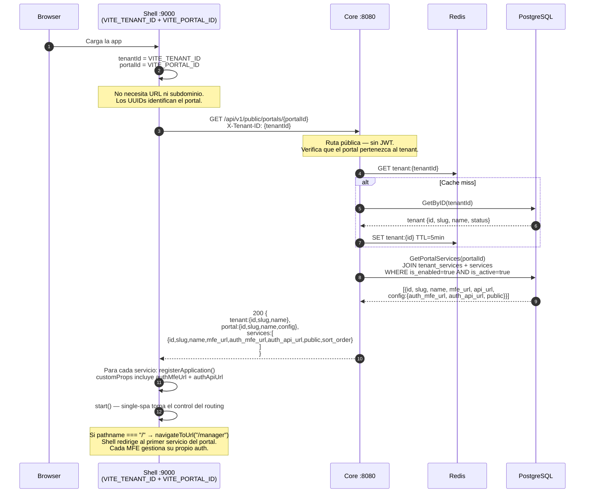
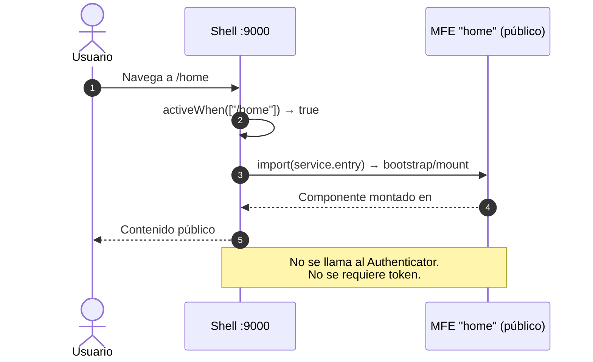
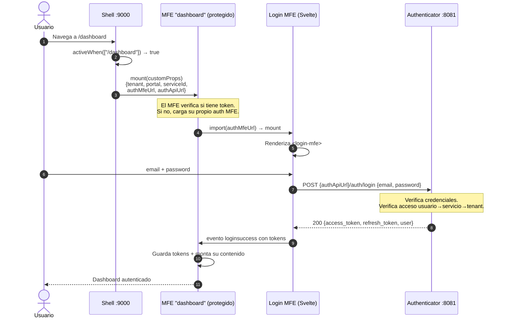
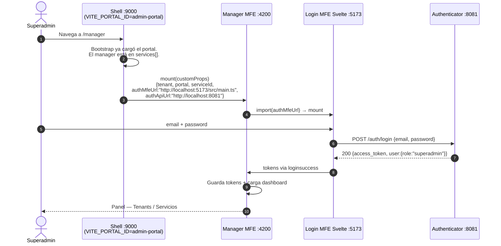
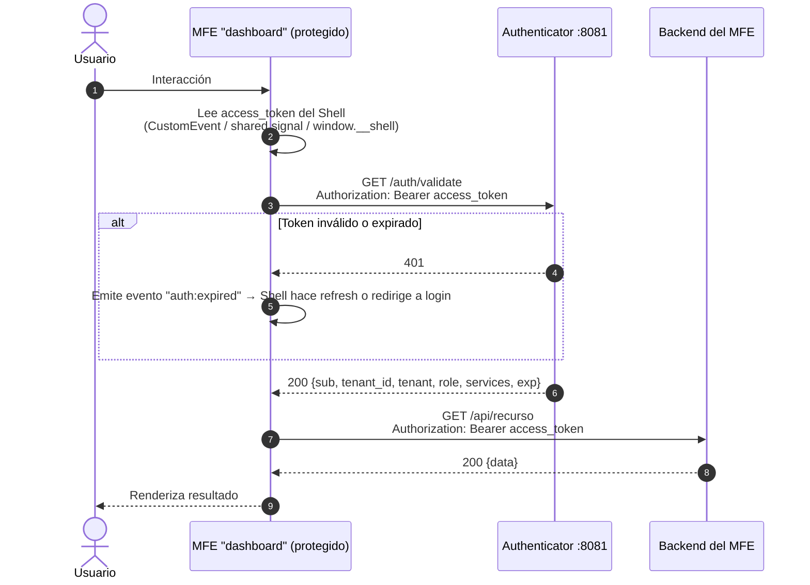
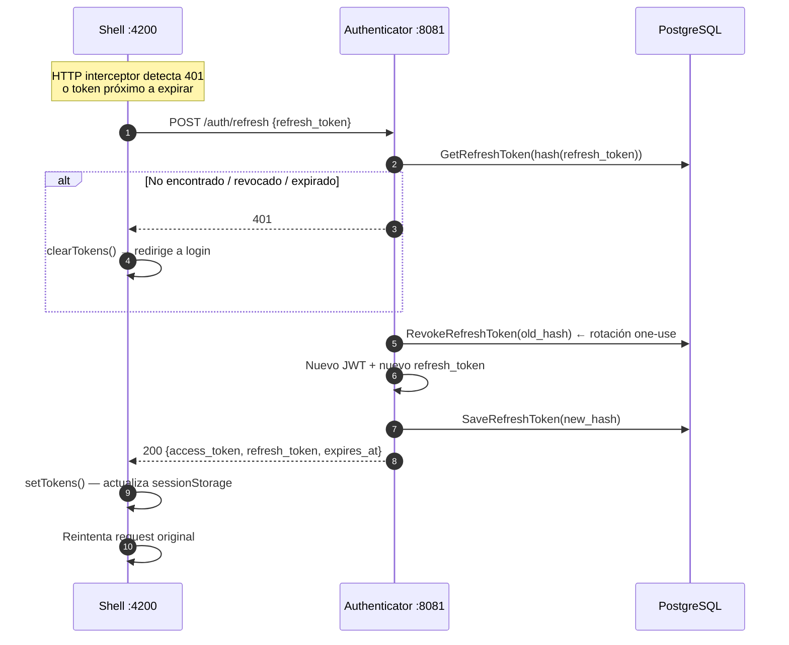
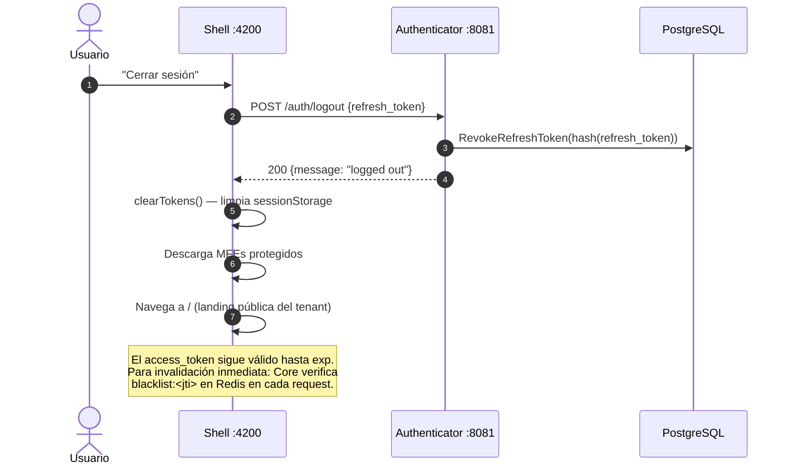
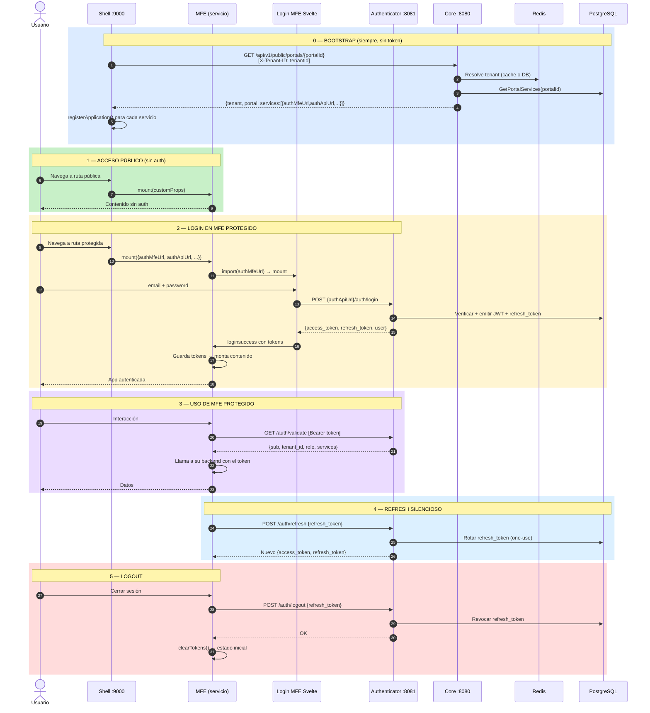

# Diagrama de Secuencia: Acceso Fluido entre Shell, Core, Authenticator y Microservicios

## Modelo de despliegue

**Un shell por portal de tenant.** Un tenant puede tener N portales; cada portal tiene su propio shell desplegado:

```
shell-admin   → VITE_TENANT_ID=<uuid-acme>  VITE_PORTAL_ID=<uuid-admin>
shell-ops     → VITE_TENANT_ID=<uuid-acme>  VITE_PORTAL_ID=<uuid-ops>
shell-cliente → VITE_TENANT_ID=<uuid-beta>  VITE_PORTAL_ID=<uuid-portal-beta>
```

Los UUIDs de tenant y portal se bajan al build (variables de entorno). El shell **no necesita URL pública ni subdominio** para identificarse — los UUIDs son suficientes. El bootstrap siempre ocurre antes del login. Cada servicio MFE gestiona su propio ciclo de auth — no existe un MFE de login global en el shell.

**Bootstrap tenant-direct (shells multi-tenant).** Cuando un servicio se asocia a un tenant directamente vía `tenant_services` (sin pasar por un Portal), no aplica el modo "un shell por portal" de arriba. Este modo es para apps compartidas entre muchos tenants (por ejemplo un `booking-admin` que sirve a N tenants), a diferencia del modo portal-bound, con marca propia, un shell por portal de tenant. En ese caso el shell resuelve sus servicios llamando a `GET /api/v1/public/services` — misma resolución de tenant que `/public/config` (header `X-Tenant-ID`, sin JWT) — que devuelve los servicios habilitados del tenant junto con su MFE URL y config de instancia, sin necesitar un `portal_id`.

| Servicio | Puerto | Responsabilidad |
|---|---|---|
| **Shell** (single-spa + Vite) | 9000 | Orquestador de MFEs por portal. Bootstrap, registro de servicios, routing |
| **Authenticator** | 8081 | Emisor autoritativo de JWT. Login, Refresh, Logout, Validate. Verifica acceso usuario→servicio→tenant |
| **Core** | 8080 | Gestión de tenants, portales y servicios. Valida JWT localmente (secreto compartido) |
| **Login MFE** (Svelte) | 5173 (dev) / 4174 (preview) | Custom element `<login-mfe>`. Usado por servicios que necesitan auth |
| **Manager** (Angular) | 4200 | Panel superadmin. Tenants, servicios, usuarios |
| **MFE de negocio** | N | Micro-frontend por servicio. Gestiona su propio auth |

---

## Flujo 0: Bootstrap del Shell (siempre ocurre, antes del login)



---

## Flujo 1: Acceso a MFE público (sin auth)

> El servicio tiene `public: true`. Se activa directo por ruta sin ningún guard.



---

## Flujo 2: Acceso a MFE protegido — el MFE gestiona su propio auth

> El servicio tiene `public: false`. El shell lo monta igual que uno público — es el MFE quien decide mostrar login si no hay sesión activa.



---

## Flujo 3: Acceso al Manager (superadmin)

> El Manager es un servicio registrado en el portal del superadmin. Su MFE gestiona su propio auth como cualquier otro servicio.



**Acceso directo al manager** (sin shell):
El Manager también expone su propia página `/login` que llama directamente a `POST http://localhost:8081/auth/login`.

---

## Flujo 4: MFE protegido llama a su backend

> El MFE ya está montado y el usuario está autenticado. El MFE valida el token con el Authenticator antes de operar.



---

## Flujo 5: Refresh silencioso



---

## Flujo 6: Logout



---

## Diagrama completo: ciclo de vida de una sesión



---

## Notas de diseño

### Shell (single-spa)

- **Un shell por portal de tenant**: Identificado por `VITE_TENANT_ID` + `VITE_PORTAL_ID` (UUIDs). No necesita URL ni subdominio. Un tenant puede tener N portales, cada uno con su propio shell y su propio conjunto de servicios.
- **Fuentes de config en orden de prioridad**: `window.__SHELL_CONFIG__` → `VITE_CORE_API_URL` + UUIDs (endpoint de portal) → `VITE_SERVICES_API_URL` → `/mock/services.json`. Ver `.env`.
- **Sin auth global**: El shell no registra un MFE de login global. No gestiona tokens, no tiene `AuthStore`, no redirecciona a `/login`. Cada servicio MFE es autónomo en su auth (ejemplo: el Manager redirige internamente a `/manager/login`).
- **Redirect inicial**: Tras `start()`, si el pathname es `/`, el shell llama a `navigateToUrl('/{primer_servicio.slug}')`. Esto garantiza que siempre se cargue un MFE al abrir la app.
- **Activación puramente por ruta**: `buildActiveWhen` activa el MFE según la URL solamente. `public: true/false` es informativo para el MFE; el shell no diferencia su comportamiento.
- **`customProps` por servicio**: Cada MFE recibe `{ domElementGetter, tenant, portal, serviceId, authMfeUrl, authApiUrl }`. Con `authMfeUrl` y `authApiUrl` el MFE puede montar su propio login sin hardcodear URLs.
- **Identificación del portal**: `resolveTenantId()` y `resolvePortalId()` en `src/config.js` leen de `window.__SHELL_CONFIG__` primero, luego de las variables de entorno.

### Core API

- **`GET /api/v1/public/portals/{portal_id}`** (header `X-Tenant-ID`): Ruta pública. Verifica que el portal pertenezca al tenant. Devuelve `{ tenant, portal, services:[{id,slug,name,mfe_url,auth_mfe_url,auth_api_url,public,sort_order}] }`. Los campos `auth_mfe_url`, `auth_api_url` y `public` salen de `service.config || portal_services.config_override` (merge JSONB).
- **`GET /api/v1/public/config`** (legacy): Ruta pública original. Resuelve tenant por `X-Tenant-Slug` header o subdominio. Mantiene compatibilidad con mocks/legados.
- **`GET /api/v1/me/context`**: Ruta protegida (JWT). Devuelve `{tenant, user, services:[]}`. Útil para MFEs que quieren verificar servicios autorizados post-login.

### Authenticator

- **MFEs sin JWT_SECRET**: Los backends de MFEs usan `GET /auth/validate` del Authenticator para introspección. No necesitan el secreto.
- **Rotación de refresh tokens**: One-use — cada `/auth/refresh` revoca el token anterior y emite uno nuevo.
- **Blacklist de access tokens**: Core verifica `blacklist:<jti>` en Redis en cada request protegido. Para logout inmediato, agregar el `jti` con TTL = tiempo restante del token.
