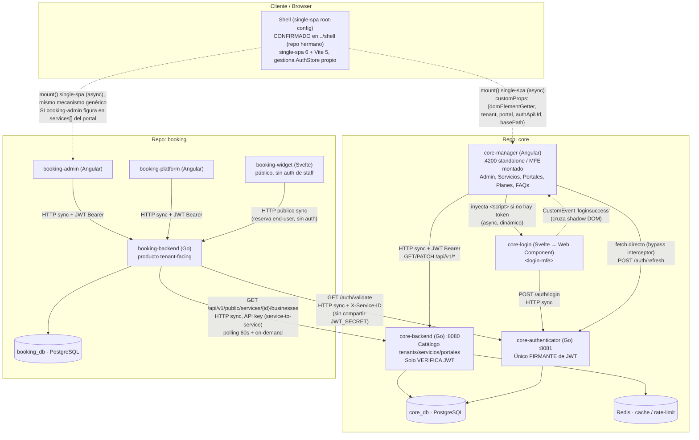
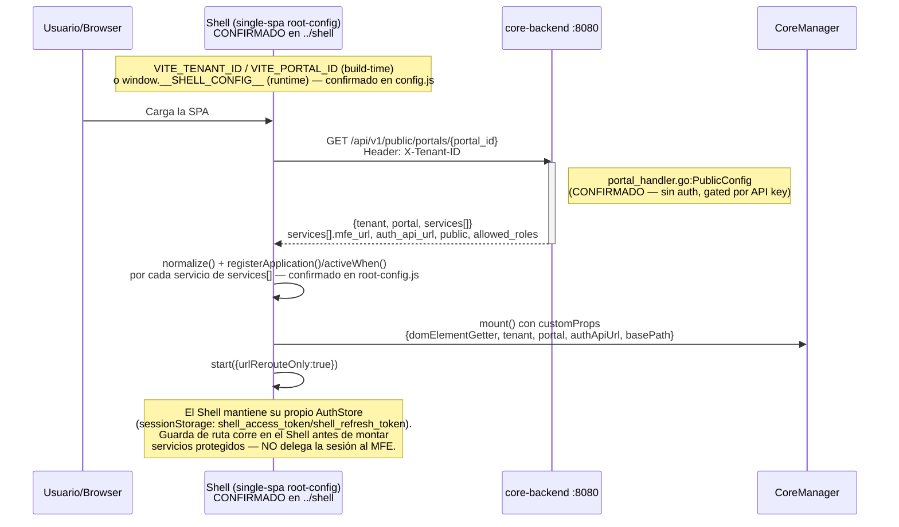
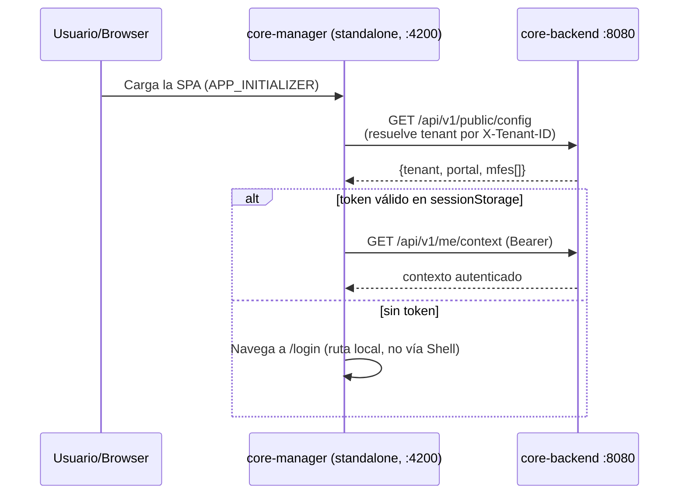
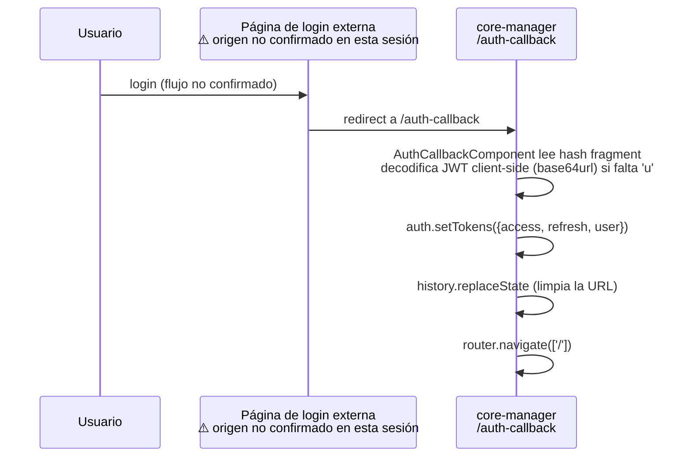
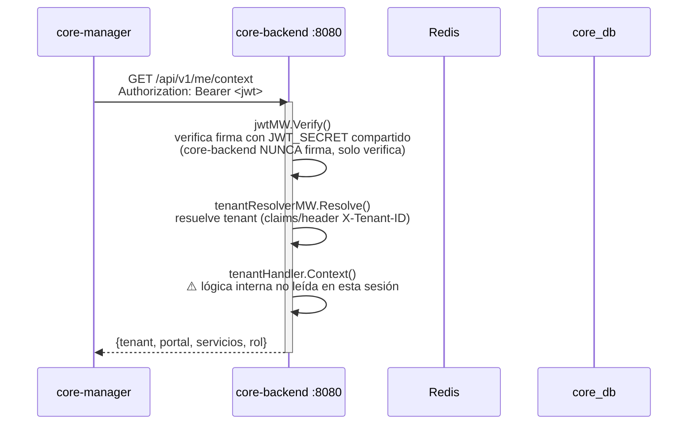
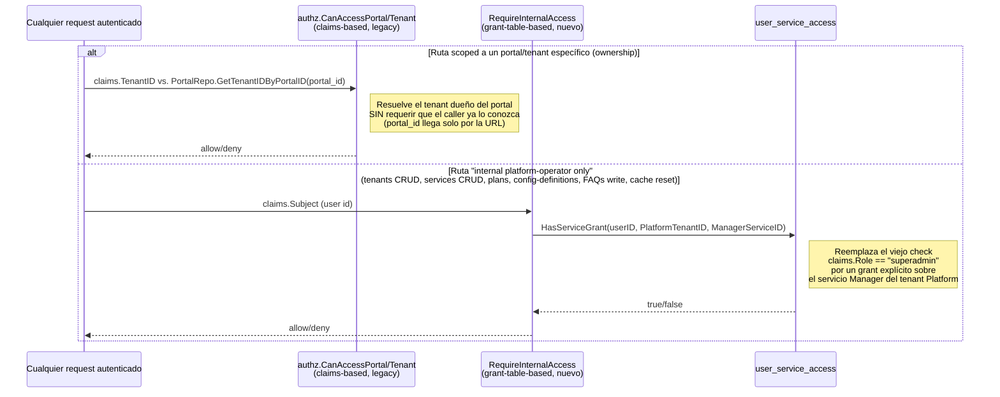
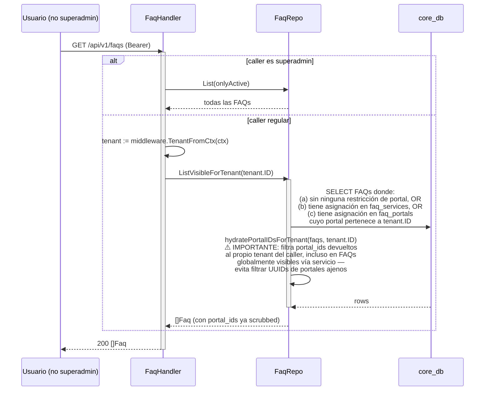
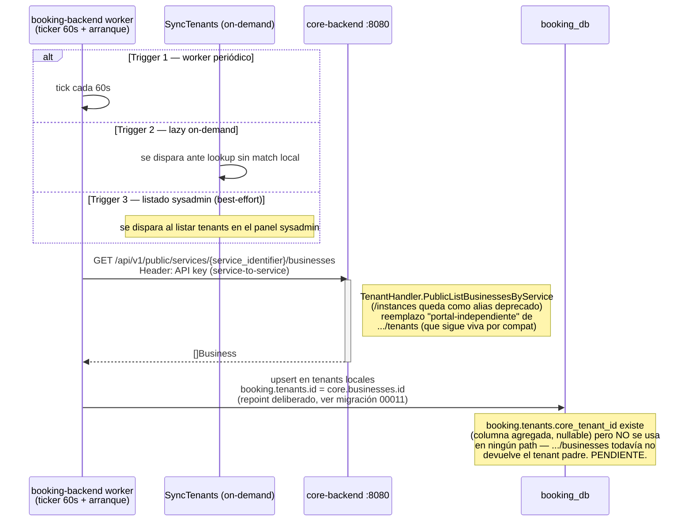
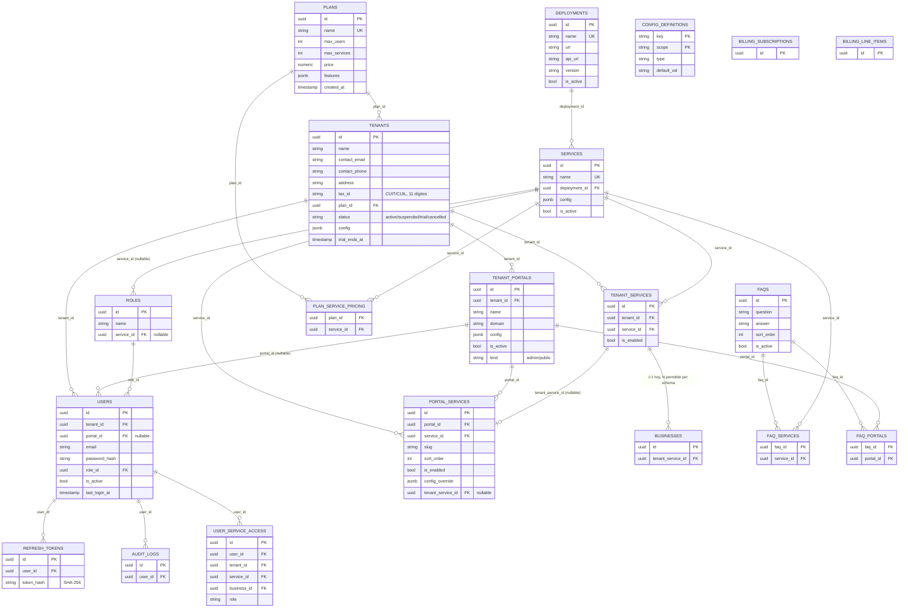

# Sistema de Tenants y Servicios — Arquitectura completa (core + booking)

> Este documento describe cómo funciona y se comunica el sistema completo de multi-tenancy: el repositorio `core` (catálogo de tenants/servicios/portales + autenticación) y el repositorio `booking` (producto tenant-facing que consume `core`). Todo lo que no pudo confirmarse leyendo directamente el código está marcado explícitamente como **pendiente / no confirmado** — no se documenta nada por inferencia sin evidencia.
>
> Repos analizados: `core` (`core-backend`, `core-authenticator`, `core-manager`, `core-login`) y `booking` (`booking-backend`, `booking-admin`, `booking-platform`, `booking-widget`).
>
> Documentos relacionados: [`auth-sequence.md`](./auth-sequence.md) (detalle del flujo de login/refresh/logout a nivel Shell), [`tenant-core-arquitectura.md`](./tenant-core-arquitectura.md) (⚠️ desactualizado — ver nota abajo), [`README.md`](./README.md) (⚠️ también desactualizado en varios puntos, ver nota abajo).

---

## 0. Nota sobre documentación previa desactualizada

- `tenant-core-arquitectura.md` describe una tabla `tenants` con columna `slug` y una herramienta de migraciones (`sql-migrate`) que ya no se usa. El código real usa **goose** (`-- +goose Up/Down`), no tiene columna `slug` en `tenants`/`services`/`tenant_portals` (fue eliminada en migraciones 009/014 y nunca restaurada), y tiene 12 tablas más que las que ese documento describe.
- `README.md` (este mismo repo) describe a `core-manager` como "el Shell" que inyecta `<script>` tags directamente y usa `GET /api/v1/public/config` como único bootstrap. El código muestra un panorama más amplio: **dos** endpoints de bootstrap público coexisten, y el Shell separado (single-spa root-config) que documenta `auth-sequence.md` **sí existe como código real**, en el repo hermano `../shell` (fuera de `core` y `booking`, por eso no se había localizado antes). Ver §3.1.
- **Corrección sobre `auth-sequence.md`**: gran parte de lo que documenta sobre el Shell está confirmado en `../shell` (bootstrap vía `GET /api/v1/public/portals/{portal_id}`, `VITE_TENANT_ID`/`VITE_PORTAL_ID`, `registerApplication`/`activeWhen`/`start`). Pero su afirmación **"Sin auth global: El shell no registra un MFE de login global. No gestiona tokens, no tiene `AuthStore`"** es **incorrecta** — el código real (`shell/src/auth.js`) sí exporta un `AuthStore` que persiste tokens en `sessionStorage` (`shell_access_token`/`shell_refresh_token`) y `root-config.js` lo usa para guardas de ruta centralizadas. El Shell **sí gestiona sesión de forma centralizada**; no delega el login a cada MFE como describen los Flujos 2/3 de `auth-sequence.md`. Ver §3.1.
- Este documento (`sistema-tenants-servicios.md`) es la fuente más reciente; en caso de conflicto con los anteriores, priorizar lo que está marcado como "confirmado" acá.

---

## 1. Panorama general — quién es responsable de qué

| Servicio | Repo | Responsabilidad | NO hace |
|---|---|---|---|
| **core-backend** (:8080, Go) | core | Catálogo de tenants, servicios, portales, planes, config-definitions, FAQs. Resuelve contexto (`/me/context`). Expone endpoints públicos con API key para que otros servicios (ej. booking-backend) consulten tenants/negocios (`businesses`). **Verifica** JWT (nunca firma). | No emite ni firma JWT. No maneja login/logout/refresh. No conoce lógica de negocio de booking (turnos, reservas, etc.). |
| **core-authenticator** (:8081, Go) | core | Único firmante de JWT. Login, refresh (rotación), logout, introspección (`/auth/validate`) para *cualquier* microservicio de la plataforma (core y booking incluidos). Resuelve grants frescos contra `user_service_access` de forma aditiva. | No conoce el catálogo de tenants/servicios/portales (solo tiene `users`/`refresh_tokens`, misma DB física `core_db` pero sin relación directa con las tablas de catálogo salvo `users.tenant_id`/`role_id`). |
| **core-manager** (Angular, :4200 o MFE montado) | core | Panel admin/superadmin: Tenants, Servicios, Portales, Planes, Config-definitions, FAQs. Gestiona su propia sesión (tokens, refresh) de forma autónoma. Puede correr standalone (dev, con su propio `/login`) o montado como MFE single-spa dentro de un Shell externo. | No es el único punto de entrada a la plataforma — no orquesta otros MFEs de negocio (eso es responsabilidad del Shell, ver §3.1). No contiene lógica de negocio de booking. |
| **core-login** (Svelte → Web Component `<login-mfe>`) | core | Formulario de login reutilizable, embebible como Custom Element. Se comunica directo con `core-authenticator`. Emite `loginsuccess`/`loginerror` como `CustomEvent` cruzando shadow DOM. | No valida ni persiste tokens — delega eso al MFE que lo embebe (ej. core-manager). |
| **Shell (single-spa root-config)** | `../shell` — repo hermano, fuera de `core` y `booking` | Orquestador genérico (single-spa 6 + Vite 5, sin framework UI, agnóstico de proyecto — no conoce nada de tenants/booking). Resuelve tenant/portal vía `VITE_TENANT_ID`/`VITE_PORTAL_ID` (build-time) o `window.__SHELL_CONFIG__` (inyección en runtime); bootstrap **confirmado** vía `GET /api/v1/public/portals/{portal_id}` con header `X-Tenant-ID`. Registra cada servicio de `services[]` con `registerApplication`/`activeWhen`, corre `start()`, y **gestiona sesión centralizada**: tiene su propio `AuthStore` (`sessionStorage`: `shell_access_token`/`shell_refresh_token`), monta el servicio con `slug === loginSlug` como Login MFE, y aplica guardas de ruta antes de montar cualquier servicio protegido. Corre en `:9000` por defecto. | Contradice a `auth-sequence.md`, que afirma "el shell no tiene `AuthStore`, cada MFE gestiona su propia sesión" — ver §3.1. Su propio `README.md` tampoco coincide del todo con el código: describe un contrato de Login MFE (`context`/`onLogin` en customProps) que `root-config.js` no implementa (usa un `CustomEvent 'loginsuccess'` global en su lugar). |
| **booking-backend** (Go) | booking | Producto tenant-facing (reservas/turnos). Valida JWT contra `core-authenticator` (`/auth/validate`), sincroniza tenants/negocios locales desde `core-backend`, aplica autorización por servicio/negocio. | No firma ni emite JWT. No es dueño del catálogo de tenants — sincroniza una copia local desde `core`. |
| **booking-admin** (Angular) | booking | Panel de administración del tenant sobre el producto booking. | No gestiona catálogo de tenants/servicios de la plataforma (eso es core-manager). |
| **booking-platform** (Angular) | booking | Interfaz de operación del producto booking (según nombre — no se profundizó en detalle en esta sesión). | Pendiente de mayor exploración. |
| **booking-widget** (Svelte) | booking | Widget embebible público para que el cliente final reserve. | No requiere autenticación de staff — es de cara al público. |

---

## 2. Diagrama de componentes — comunicación entre servicios



**Notas del diagrama:**
- `core-backend` y `core-authenticator` comparten la instancia física de `core_db`, pero cada uno accede solo a sus tablas (catálogo vs. `users`/`refresh_tokens`). No hay una API interna entre ambos — la única comunicación es indirecta vía JWT (uno firma, el otro solo verifica) y vía `booking-backend`/`core-manager` llamando a `/auth/validate`.
- `booking-backend` **nunca** valida el JWT localmente ni conoce `JWT_SECRET` — siempre delega en `GET /auth/validate` de `core-authenticator`. Esto es un contraste directo con `core-backend`, que sí verifica localmente (comparte el mismo secreto).
- La flecha Shell→MFEs está punteada porque el `mount()` es asíncrono (`import()` dinámico), no por incertidumbre sobre su existencia — el mecanismo está confirmado en `../shell/src/root-config.js` (ver §3.1). El Shell es 100% genérico: monta cualquier servicio que la API de portal le devuelva en `services[]`, sin lógica específica de core-manager o booking-admin.

---

## 3. Diagramas de secuencia

### 3.1 Bootstrap del Shell + resolución de portal + carga de MFEs

**Estado: CONFIRMADO** — código real leído en `../shell` (repo hermano, `src/root-config.js`, `src/config.js`, `src/api.js`, `src/auth.js`, `package.json`, `README.md`).

Además existen **dos** endpoints de bootstrap público distintos, ambos confirmados en `cmd/api/main.go`:
- `GET /api/v1/public/config` (resuelve el tenant por header `X-Tenant-ID` o claims del JWT, vía `tenantResolverMW`; ya no hay resolución por dominio desde la migración 037) — el que documenta `README.md` (usado por `core-manager` standalone, vía `booking-admin`/`booking-platform` `tenant.service.ts` también).
- `GET /api/v1/public/portals/{portal_id}` (resuelve portal por **ID explícito** + header `X-Tenant-ID`) — el que consume el Shell real (`../shell/src/config.js:resolveSource()`), pensado para el modelo "una instancia de Shell por tenant+portal" con IDs fijados en build-time.



**Discrepancia con `auth-sequence.md` — documentada explícitamente, no asumida:**

`auth-sequence.md` (Flujos 2/3 y "Notas de diseño") describe un modelo donde "el shell no gestiona tokens, no tiene `AuthStore`" y cada MFE monta su propio Login MFE vía un customProp `authMfeUrl` que recibe. El código real de `../shell/src/root-config.js` no coincide:
- `customProps` reales son `{domElementGetter, tenant, portal, authApiUrl, basePath}` — **no existen** `serviceId` ni `authMfeUrl` en el objeto que arma `root-config.js` (sí figuran en el contrato que documenta `shell/README.md`, que tampoco coincide con el código — ver más abajo).
- El Login MFE no lo monta cada servicio por su cuenta: el propio Shell registra, como una app single-spa más, el servicio cuyo `slug === loginSlug`, activo en la ruta `/login`.
- El Shell escucha un `CustomEvent('loginsuccess')` global en `window`, y es él quien llama a `AuthStore.setTokens()`, valida `allowedRoles` y navega — sesión centralizada, no delegada.
- El `shell/README.md` (dentro del mismo repo `../shell`) tampoco coincide con `root-config.js`: documenta un contrato de Login MFE con props `context: {service, tenant}` y callback `onLogin(tokens)` que el código no pasa ni invoca — es la versión más desactualizada de las tres fuentes.

En síntesis, para lo que realmente importa a este documento (`core`/`booking`): el Shell es genérico y punto único de autenticación centralizada cuando está presente; `core-manager` standalone (sin Shell) sigue gestionando su propia sesión de forma autónoma como describe §3.2 — ambos modelos coexisten según cómo se despliegue `core-manager`.

**Camino alternativo confirmado — core-manager standalone (dev, sin Shell):**



---

### 3.2 Login completo (core-login → core-authenticator → core-manager)

**Estado: confirmado, con dos mecanismos coexistentes distintos.**

**Mecanismo A — CustomEvent (MFE embebido, documentado en `auth-sequence.md`):**

```mermaid
sequenceDiagram
    participant U as Usuario
    participant CL as core-login (&lt;login-mfe&gt;, Svelte WC)
    participant CM as core-manager (Angular)
    participant CA as core-authenticator :8081

    CM->>CM: authGuard detecta ausencia de token
    CM->>CL: inyecta &lt;script src="auth_mfe_url"&gt;<br/>+ atributo config JSON
    U->>CL: completa formulario
    CL->>CA: POST /auth/login {email, password, tenant_id?}
    activate CA
    Note right of CA: bcrypt.Compare · genera access+refresh<br/>hash SHA-256 del refresh token
    CA-->>CL: {access_token, refresh_token, user}
    deactivate CA
    CL-->>CM: CustomEvent 'loginsuccess' {composed:true}<br/>(cruza shadow DOM)
    CM->>CM: NgZone.run(() => auth.setTokens(...))<br/>guarda en sessionStorage:<br/>shell_access_token / shell_refresh_token / shell_user
    CM->>CM: mirror a window.__SHELL_CONTEXT__.accessToken<br/>(si existe, para compartir con el Shell)
    CM->>CM: router.navigate(['/'])
```

**Mecanismo B — Redirect / SSO callback vía URL hash (confirmado en `auth-callback.component.ts`, NO documentado en `auth-sequence.md`):**



> ⚠️ **No confirmado**: la relación/precedencia exacta entre estos dos mecanismos (¿el Mecanismo B es un SSO iniciado por el propio Shell? ¿por otro MFE? ¿un IdP externo?) no se pudo determinar en esta sesión — ambos existen en el código pero no hay evidencia directa de qué los dispara en la práctica.

---

### 3.3 Validación de JWT para un request autenticado en core-backend (`/me/context`)

**Estado: cadena de middleware confirmada en `main.go`; lógica interna del handler `tenantHandler.Context` NO leída en esta sesión — no se detalla su implementación exacta.**



---

### 3.4 Cómo booking-backend valida un JWT emitido por core-authenticator

**Estado: confirmado en código completo (`booking-backend/internal/auth/client.go`, `internal/http/middleware.go`).**

```mermaid
sequenceDiagram
    participant BA as booking-admin / booking-platform
    participant BB as booking-backend
    participant CA as core-authenticator :8081

    BA->>BB: request con Authorization: Bearer <jwt>
    activate BB
    BB->>BB: RequireTenantAccess middleware
    BB->>CA: GET /auth/validate<br/>Header: X-Service-ID<br/>Header: X-Business-ID (opcional;<br/>X-Service-Instance-ID legacy, deprecado)
    activate CA
    Note right of CA: AuthHandler.Validate:<br/>decodifica claims + resuelve grant fresco<br/>contra user_service_access (aditivo)
    CA-->>BB: {sub, tenant_id, role, services[],<br/>business_id?, resolved_role?}<br/>(+ service_instance_id legacy, mismo valor)
    deactivate CA
    alt 401 de core-authenticator
        BB-->>BA: 401 invalid or expired token
    else claims.BusinessID vacío
        BB-->>BA: 403 no resolvable business<br/>(NO hay fallback silencioso a tenant_id)
    else OK
        BB->>BB: resolver.ByID(ctx, business_id)<br/>tenants.id local == core businesses.id
        BB->>BB: EffectiveRole() = resolved_role ?? role<br/>(prefiere el rol fresco del grant table)
        BB-->>BA: 200 + datos del recurso
    end
    deactivate BB
```

**Detalle clave**: `booking-backend` nunca comparte `JWT_SECRET` con `core` — la validación es siempre por HTTP contra `/auth/validate`, nunca local. Esto es una diferencia de diseño explícita frente a `core-backend`, que sí valida localmente por compartir el secreto.

---

### 3.5 Control de acceso usuario↔servicio vía `user_service_access`

**Estado: confirmado — dos mecanismos coexisten.**



**Confirmado en `internal_access.go`**: `RequireInternalAccess` es hoy el guard real sobre las rutas de administración de plataforma (`/api/v1/tenants` POST/DELETE/GET-all, `/api/v1/services` write, `/api/v1/plans` write, `/api/v1/config-definitions` write, `/api/v1/cache/reset`, `/api/v1/faqs` write) — no un simple check de rol embebido en el JWT, sino una consulta fresca a `user_service_access` sobre un grant fijo (`PlatformTenantID` + `ManagerServiceID`, ambos UUIDs fijos del seed).

---

### 3.6 Asignación/resolución de FAQs visibles (servicio/portal → FAQ visible)

**Estado: confirmado en código completo (`faq_handler.go`, `faq_repo.go`).**



---

### 3.7 Sincronización de negocios (businesses) entre booking y core

**Estado: mecanismo confirmado; sincronización de datos adicionales (nombre del tenant padre, etc.) marcada como pendiente.**



---

## 4. Esquema de datos — `core_db` (confirmado vía migraciones 001–031, goose)

> ⚠️ No confía en `tenant-core-arquitectura.md`. Reconstruido leyendo migraciones + structs de dominio directamente.



**Notas relevantes del schema:**
- `tenants`, `services` y `tenant_portals` **no tienen columna `slug`** — fue eliminada en migraciones 009/014 y nunca restaurada. El slug hoy vive únicamente en `portal_services.slug` (por servicio-dentro-de-portal).
- La migración 026 está genuinamente ausente en la secuencia 001–031 — no se pudo determinar la causa (¿renumeración, migración descartada?). Pendiente de confirmar con el equipo.
- La migración 036 introduce `deployments` (una app desplegada una sola vez por la plataforma, con una `url` canónica). Cada servicio se apoya en un deployment (`services.deployment_id NOT NULL`, N servicios : 1 deployment); `services.mfe_url`/`version` pasaron a `deployments.url`/`version`, y la API sigue devolviendo `mfe_url`/`version` resueltos vía JOIN. Se eliminó `services.is_internal` (migración 023): ningún código lo leía; el acceso interno se decide por grants sobre el servicio Manager (`…0010`).

---

## 5. Datos semilla — tenant "Platform" y servicios Manager/Login

Confirmado en `core-backend/internal/seed/seed.go` (idempotente, `ON CONFLICT DO NOTHING`, gated por `SEED_ADMIN_EMAIL`/`SEED_ADMIN_PASSWORD`):

- Tenant fijo **Platform** (`plan: enterprise`) con UUID fijo.
- Portal fijo **Admin Portal**, dentro del tenant Platform.
- Servicios fijos **Login** (`config.public = true`) y **Manager** (`config.public = false`), ambos asignados al Admin Portal vía `portal_services` con slugs `"login"`/`"manager"`.
- Usuario superadmin inicial, creado una sola vez (verificado con `EXISTS` sobre `roles.name = 'superadmin'`).
- Estos UUIDs fijos (`PlatformTenantID`, `ManagerServiceID`) son los mismos que usa `RequireInternalAccess` (§3.5) para decidir quién es "staff de plataforma" — la relación entre el seed y el modelo de autorización nuevo es directa y deliberada.

---

## 6. Hallazgos importantes — bugs y observaciones de alta confianza

| # | Hallazgo | Evidencia | Confianza |
|---|---|---|---|
| 1 | **Bug probable**: `business_repo.go` `ListByService` tiene un fallback que consulta `services.slug`, columna eliminada en la migración 014 y nunca restaurada (confirmado hasta la migración 031). Ese camino del código fallaría en runtime si se ejercita. | Lectura directa de `business_repo.go` + `domain/service.go` (sin campo `Slug`) + migraciones. | Alta |
| 2 | `TenantRepository.ListByService(ctx, serviceIdentifier string)` tiene una firma que sugiere el mismo patrón ambiguo UUID-o-slug que el hallazgo #1, pero **no se verificó directamente el SQL de `tenant_repo.go`** — no leído en esta sesión. | Interfaz en `domain/tenant.go` únicamente. | Media — pendiente de verificar `tenant_repo.go` |
| 3 | `booking.tenants.id` fue deliberadamente repointeado para almacenar `core.businesses.id` (no `core.tenants.id`). La columna `core_tenant_id` existe pero está sin usar — `.../businesses` todavía no devuelve el tenant padre. | Migración `00011_add_core_tenant_id.sql` + `client.go`/`middleware.go` de booking-backend. | Alta |
| 4 | Coexisten dos modelos de autorización: el legacy basado en claims del JWT (`authz.CanAccessPortal/Tenant`) y el nuevo basado en grants frescos contra `user_service_access` (`RequireInternalAccess`). Ambos activos simultáneamente sobre rutas distintas. | `authz.go`, `internal_access.go`, `main.go` (route table). | Alta |
| 5 | **Resuelto**: el paquete "Shell" (single-spa root-config) descrito en `auth-sequence.md` existe como código real en el repo hermano `../shell` (single-spa 6 + Vite 5). Llama a `GET /api/v1/public/portals/{portal_id}` como documenta `auth-sequence.md`, pero a diferencia de lo que ese doc afirma, **sí gestiona sesión centralizada** con su propio `AuthStore` — ver §3.1. | Lectura directa de `../shell/src/root-config.js`, `config.js`, `api.js`, `auth.js`. | Alta |
| 6 | Dos mecanismos de login coexisten en `core-manager`: CustomEvent (`loginsuccess`, documentado en `auth-sequence.md`) y redirect/URL-hash SSO callback (`auth-callback.component.ts`, no documentado en ningún doc previo). Su relación/precedencia no está clara. | Lectura completa de ambos archivos. | Alta (existencia de ambos), Baja (relación entre ellos) |
| 7 | El JWT blacklist vía Redis (`blacklist:<jti>`) que documenta `auth-sequence.md` para logout inmediato **no se cross-verificó** contra el código real de `core-backend`/`core-authenticator` en esta sesión — podría ser aspiracional. | Solo evidencia documental, sin lectura de código de blacklist. | Baja — pendiente |
| 8 | La migración 026 está ausente en la secuencia 001–031, sin explicación encontrada en el código. | Lectura de todas las migraciones. | Alta (el gap existe), causa desconocida |

---

## 7. Preguntas abiertas / pendientes para el equipo

- ¿Cuál es el origen real del Mecanismo B de login (SSO redirect vía `auth-callback.component.ts`)? ¿Qué lo dispara?
- ¿`TenantRepo.ListByService` tiene el mismo bug de `slug` que `BusinessRepo.ListByService`?
- ¿Por qué falta la migración 026?
- ¿Se planea completar el repoint `booking.tenants.core_tenant_id` para que `.../businesses` devuelva el tenant padre?
- El blacklist de JWT vía Redis — ¿implementado, planeado, o descartado?

---

*Generado a partir de lectura directa de código en `core` y `booking` (migraciones 001–031, handlers, middlewares, domain structs, servicios Angular/Svelte). Fecha: 2026-08-29.*
